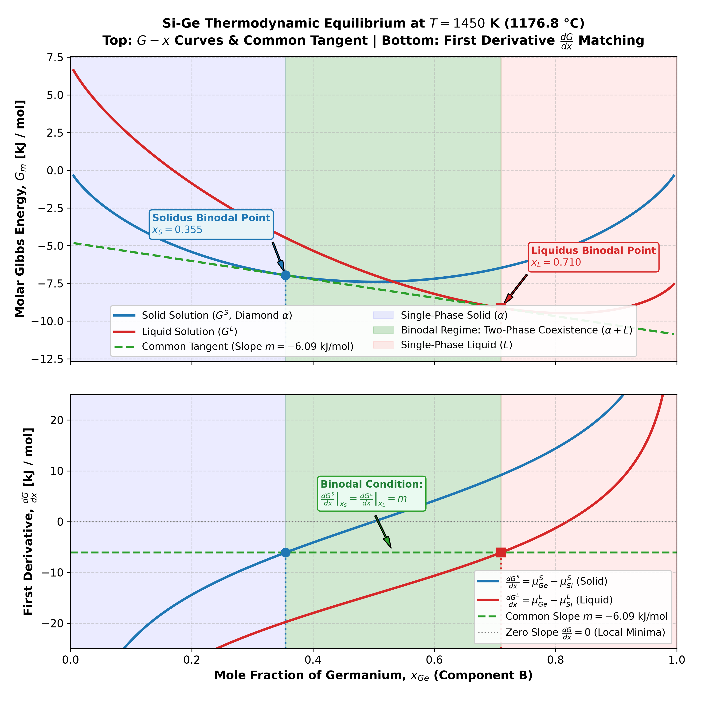
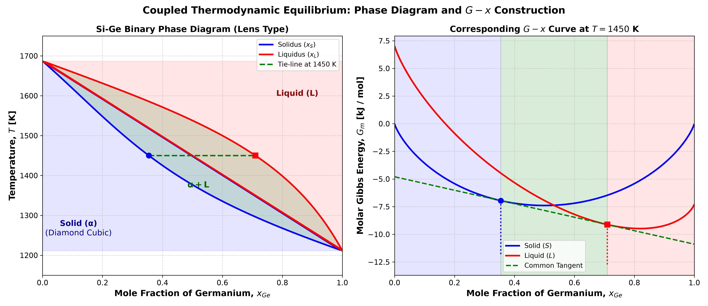
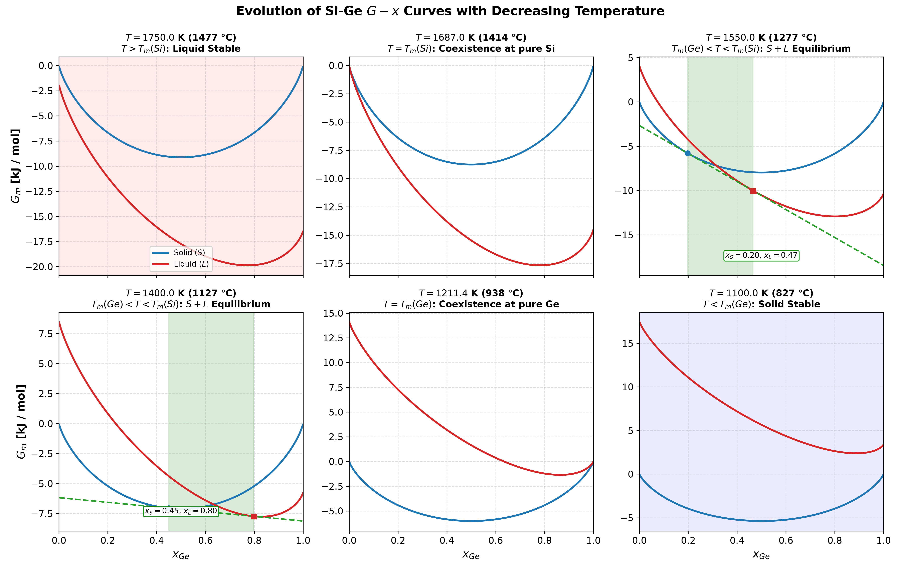
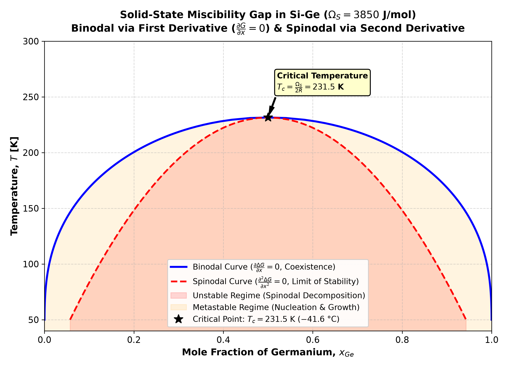

# Si-Ge Thermodynamic Modeling & Binodal Regime

Thermodynamic modeling and phase equilibria calculation for the binary Silicon–Germanium ($\text{Si}-\text{Ge}$) alloy system using Python (`NumPy`, `SciPy`, and `Matplotlib`).

## Features
- **$G-x$ Curves:** Molar Gibbs free energy vs. composition for Solid (Diamond cubic, $\alpha$) and Liquid ($L$) solutions.
- **Common Tangent Construction:** Equal chemical potentials ($\mu_i^S = \mu_i^L$) to find equilibrium solidus ($x_S$) and liquidus ($x_L$).
- **First-Derivative Analysis:** Demonstrating the slope matching condition $\left.\frac{dG^S}{dx}\right|_{x_S} = \left.\frac{dG^L}{dx}\right|_{x_L} = m_{\text{tangent}}$ and contrasting with $\frac{dG}{dx} = 0$.
- **Binary Phase Diagram:** Complete lens-shaped isomorphous $T-x$ phase diagram with the shaded **Binodal Regime** ($\alpha + L$ coexistence).
- **Subcritical Miscibility Gap:** Low-temperature solid solution phase separation below $T_c = 231.5\text{ K}$ with both **Binodal** ($\frac{\partial \Delta G}{\partial x} = 0$) and **Spinodal** ($\frac{\partial^2 \Delta G}{\partial x^2} = 0$).

---

## Generated Plots

### 1. $G-x$ Curve & First Derivative Matching ($T = 1450\text{ K}$)


### 2. Coupled Phase Diagram & Isothermal Tie-Line


### 3. Multi-Temperature $G-x$ Evolution


### 4. Low-Temperature Solid-State Miscibility Gap


---

## Thermodynamic Parameters (SGTE / Literature)
- **Silicon ($\text{Si}$):** $T_m = 1687.0\text{ K}$, $\Delta H_m = 50{,}210\text{ J/mol}$
- **Germanium ($\text{Ge}$):** $T_m = 1211.4\text{ K}$, $\Delta H_m = 36{,}940\text{ J/mol}$
- **Regular Solution Parameters:**
  - Solid: $\Omega_S = 3{,}850\text{ J/mol}$
  - Liquid: $\Omega_L(T) = 6{,}610 - 0.354 \, T\text{ J/mol}$

---

## Quick Start & Usage

```bash
# Install dependencies
pip install numpy scipy matplotlib

# 1. Run basic G-x plot and phase diagram generator
python3 plot_si_ge_gx.py

# 2. Run detailed binodal and first-derivative analysis
python3 plot_si_ge_binodal.py
```

---

## References
1. **Dinsdale, A. T. (1991).** *"SGTE data for pure elements."* *CALPHAD*, 15(4), 317–425.
2. **Olesinski, R. W. & Abbaschian, G. J. (1984).** *"The Ge-Si system."* *Bull. Alloy Phase Diagr.*, 5(2), 180–183.
3. **Mullis, A. M. (2003).** *"Rapid solidification in the Si-Ge system."* *Mater. Sci. Eng. A*, 375–377, 542–546.
4. **Porter, D. A., Easterling, K. E. & Sherif, M. Y. (2009).** *Phase Transformations in Metals and Alloys* (3rd ed.). CRC Press.
